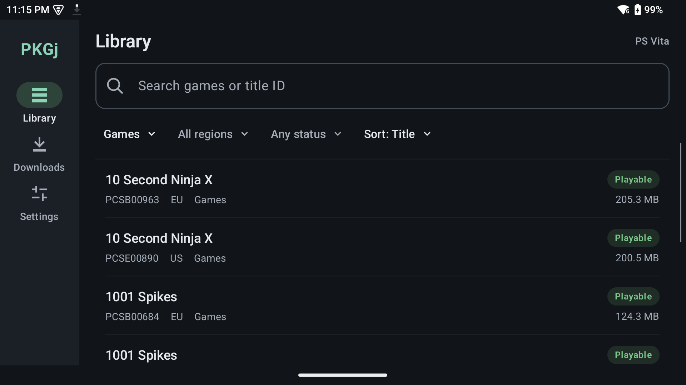

# PKGj Android Catalog

An Android port of [PKGj for PS Vita](https://github.com/blastrock/pkgj), rebuilt natively for Android.
This repository does not include or build the Vita application.

Browse PS Vita, PSP, PS1 and PS3 catalogs, search and filter titles, queue PKG downloads, and save packages and available license files to a folder you choose.

Vita games include Vita3K compatibility pills; PS3 games include RPCS3 pills. Both have status filters.



## Build on Linux

Install Android Studio or the Android SDK, Android platform/build tools for API 35, and a JDK 17. The Gradle wrapper downloads the pinned Gradle version on first use.

```sh
./android/gradlew -p android test lint assembleDebug
```

The debug APK is `android/app/build/outputs/apk/debug/app-debug.apk`. Its application ID is `org.pkgj.android.catalog`.

Install it on a connected Android device with USB debugging enabled:

```sh
adb devices
adb install -r android/app/build/outputs/apk/debug/app-debug.apk
```

To launch it from ADB:

```sh
adb shell am start -n org.pkgj.android.catalog/org.pkgj.android.MainActivity
```

## Controls

D-pad or left stick to navigate, A to select, B to go back. L1/R1 switch tabs. L2/R2 or the right stick page through lists; hold a trigger to scroll faster.

## Game updates

For Vita and PS3, **Download** queues the game and its available updates in your chosen folder. Details load update info automatically; **Download update** saves just the patch, and the refresh icon checks again. PS3 downloads retain the full update sequence. Updates use the exact regional Title ID and separate versioned filenames, with no extra license file. PSP and PS1 have no verified update feed in the upstream projects.

For Vita, install the base game in Vita3K first, then select the update through **Install .pkg**. Use the matching game license if Vita3K prompts for one. For PS3, install the downloaded updates in manifest order. The app cannot see your installed version.

## Notes

- Catalogs and compatibility reports are fetched from their public upstream sources and cached for offline use. Custom catalog URLs and local TSV imports are supported.
- Compatibility reports come from Vita3K for Vita games and RPCS3 for PS3 games, matched by exact Title ID. Ratings are not a guarantee of performance on your device.
- PS3 catalogs support NoPayStation TSV and PKGi PS3 CSV. Supplied RAP data is saved as a 16-byte `CONTENTID.rap` file. No console-specific PS3 RIF is generated.
- PSP and PS1 downloads are original PSN PKG files; ISO, PBP or disc-image conversion is not implemented.
- Choose a separate download folder for each platform in **Settings > Folders**. New downloads go directly there; existing jobs and their automatic updates keep their original folder. Vita3K handles installation and license selection. Older downloads stored inside the app can be moved with **Save to folder**.
- **Clear history** on Downloads removes saved and canceled entries without deleting files. Unfinished jobs remain available.
- No game files, credentials, or license material are bundled.

See [docs/android-port.md](docs/android-port.md) for architecture, catalog formats, Vita3K integration findings, limitations, and the device test checklist.

## License

BSD 2-Clause. See [LICENSE](LICENSE) for the original PKGj copyright notices and terms. The Android app also includes the license in its APK.
