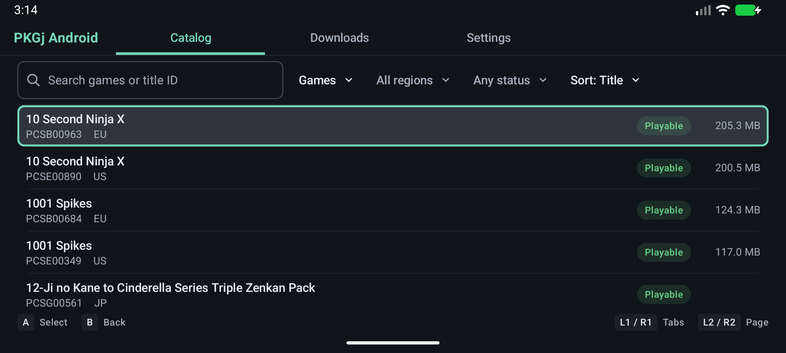
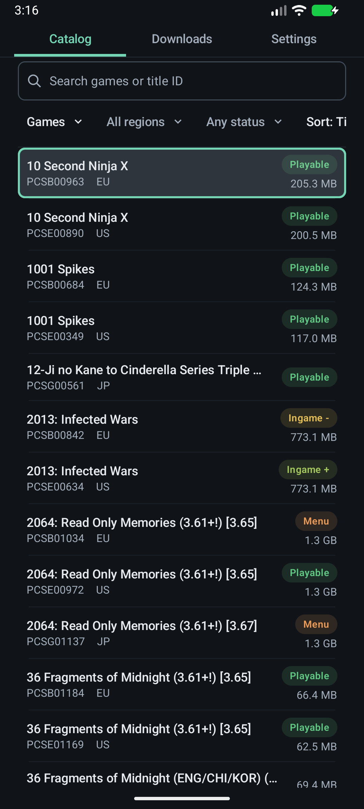
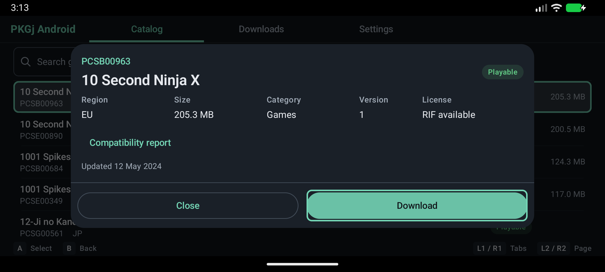
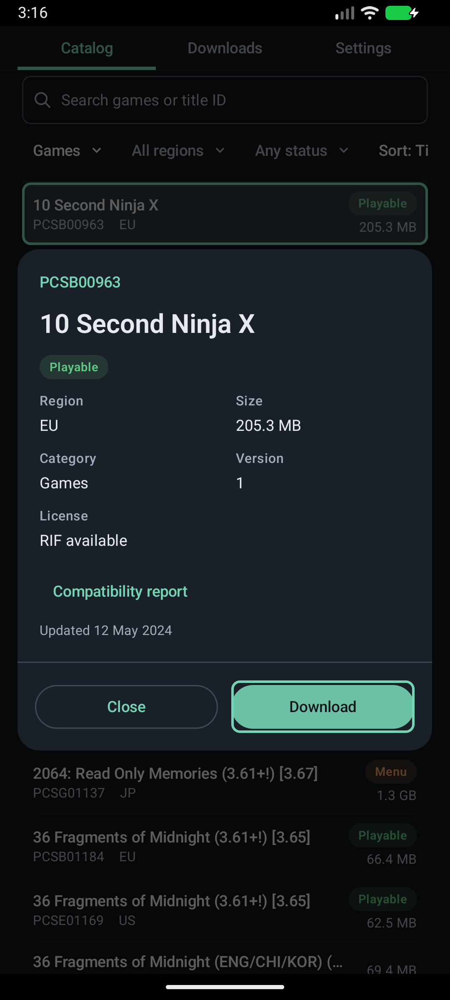
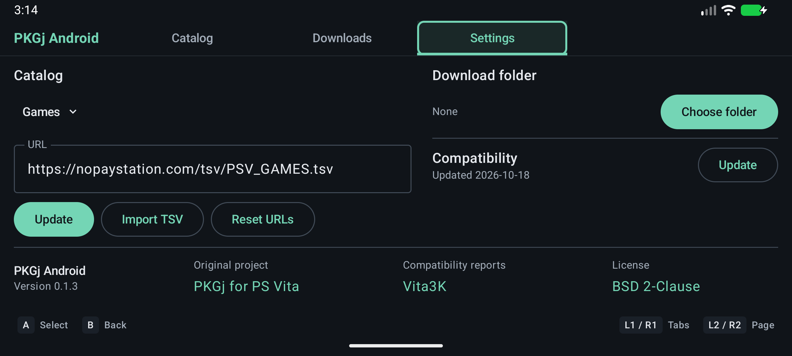
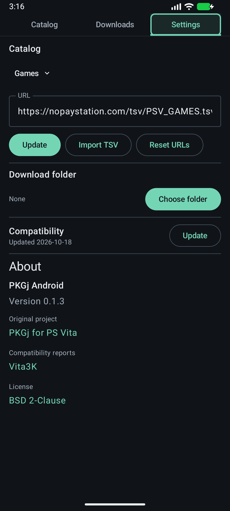
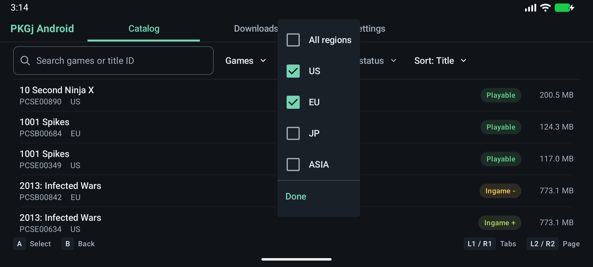
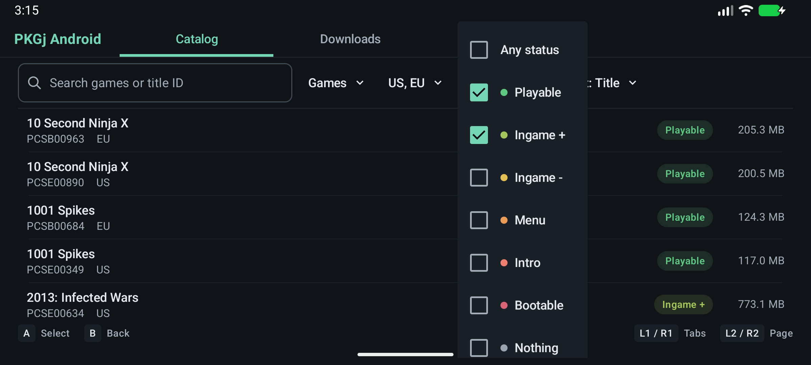

# Screenshots

PKGj Android 0.1.3, captured with Android Studio's installed Android 17/API 37 emulator. These are emulator screenshots, not Odin captures. No game files were downloaded.

| Screen | Landscape | Portrait |
| --- | --- | --- |
| Catalog |  |  |
| Game details |  |  |
| Settings |  |  |

[Downloads with an empty queue](portrait/downloads-empty.png).

## Filters

| Regions | Compatibility |
| --- | --- |
|  |  |
